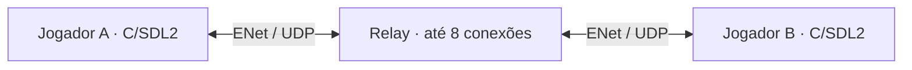

<div align="center">

# Pokémon Emerald Multiplayer

**Explore Hoenn com outros jogadores — uma base multiplayer experimental para Linux.**

C / SDL2 · ENet · Linux 32 bits · Alpha

[Apresentação](#apresentação-do-projeto) · [Como executar](#como-executar) · [Arquitetura](#arquitetura) · [Objetivos e To-Do](#objetivos-e-to-do)

</div>

---

## Apresentação do projeto

O Pokémon Emerald Multiplayer adiciona uma camada de rede ao port nativo C/SDL2
de Pokémon Emerald. O primeiro objetivo é permitir que jogadores se conectem a
um servidor e vejam uns aos outros no mesmo mapa do mundo do jogo (*overworld*).

O projeto está em **fase experimental**, no checkpoint `v0.1.0-alpha.3`, com
protocolo de rede 2. O foco atual é validar essa base antes de adicionar novas
mecânicas.

| Recurso | Situação atual |
| --- | --- |
| Executável Linux nativo de 32 bits | Compilado; inicialização e encerramento testados sem janela |
| Conexão e troca de posições pela internet | Aprovadas em testes automatizados x86_64 e i386 |
| Jogadores remotos no mesmo mapa | Implementado; validação visual com dois jogadores pendente |
| Controles, áudio e persistência do save | Validação manual pendente nesta build |
| IP e porta personalizados | Disponíveis por configuração local; menu no jogo planejado |
| Chat, batalhas e trocas multiplayer | Propostas para etapas futuras |

> **O que esperar da alpha:** os testes de rede passaram, mas ainda precisamos
> confirmar dois jogadores visíveis dentro do jogo. O primeiro marco funcional
> permanece aberto.

O repositório disponibiliza fontes, ferramentas, testes e documentação. ROM,
jogo compilado, saves e pacotes locais **não são publicados no GitHub**, inclusive
em Releases ou artefatos de CI. Veja a [política de distribuição](docs/distribution.md).

## Como executar

O caminho abaixo prepara o projeto do zero. Se o executável já estiver em
`build/linux-port/pokeemerald`, siga diretamente para
[configurar e iniciar](#4-configurar-e-iniciar).

### 1. Conferir os requisitos

| Requisito | Detalhe |
| --- | --- |
| Sistema | Ambiente de referência: Fedora 44 em x86_64 |
| Bibliotecas | Versões de **32 bits (i686)**, mesmo em sistema de 64 bits |
| Ferramentas | Git, Python 3, Make, GCC/G++, pkg-config e utilitário `file` |
| ROM local compatível | Pokémon Emerald USA/Europe, conferida pelo SHA-1 abaixo |
| Servidor multiplayer | Relay compatível com o protocolo 2, IPv4 e porta UDP conhecidos |

Instale as dependências no Fedora:

```bash
sudo dnf install -y git python3 make gcc gcc-c++ pkgconf-pkg-config file \
    glibc-devel.i686 libgcc.i686 sdl2-compat-devel.i686 \
    SDL2_image-devel.i686 mesa-libGL-devel.i686 mesa-libGLU-devel.i686 libpng-devel
```

Esses são os pacotes usados no ambiente de referência. Outras distribuições
precisam das dependências equivalentes e de validação própria. Windows e Android
estão no backlog.

A ROM deve ter SHA-1 `f3ae088181bf583e55daf962a92bb46f4f1d07b7`.
Ela serve para verificar a revisão suportada: não é modificada nem copiada pelo
preparador. O executável é compilado dos fontes.

### 2. Obter os fontes

```bash
git clone --branch multiplayer/initial-linux https://github.com/TamyDB/pokeemerald-mp.git
cd pokeemerald-mp
```

Os próximos comandos devem ser executados na raiz desse repositório.

Obtenha também a revisão fixa do port SDL2 em uma pasta separada:

```bash
git clone https://github.com/gradenGnostic/pokeemerald-multiplatform.git /tmp/pokeemerald-linux-port
git -C /tmp/pokeemerald-linux-port checkout db1cab3d2dc9f0e0a9f4a3d67983e5acf30a9a46
```

Use uma pasta vazia para esse clone. Se `/tmp/pokeemerald-linux-port` já existir,
confira seu conteúdo ou escolha outro caminho e ajuste o comando da próxima etapa.

### 3. Preparar e compilar

Substitua o caminho da ROM pelo caminho do seu arquivo local:

```bash
python3 scripts/prepare_linux.py \
    --source /tmp/pokeemerald-linux-port \
    --rom '/caminho/para/Pokemon - Emerald Version (USA, Europe).gba'
./scripts/build_linux.sh
```

O preparador exige o checkout upstream limpo na revisão indicada e cria o port
integrado em `build/linux-port`. Ele recusa um destino já existente. Se precisar
preparar novamente, preserve saves e configurações e mova a pasta anterior antes.

Ao final, o executável estará em `build/linux-port/pokeemerald`. Para recompilar
após alterações na camada de rede, execute apenas `./scripts/build_linux.sh`.
Mais detalhes: [guia da build Linux](docs/linux-playable.md).

### 4. Configurar e iniciar

**Sem rede:**

```bash
env -u POKE_NET_SERVER -u POKE_NET_PORT ./scripts/play_linux.sh
```

**Com multiplayer:** copie o modelo uma única vez, preservando configurações existentes:

```bash
if [ ! -f config/multiplayer.env ]; then
    cp config/multiplayer.env.example config/multiplayer.env
fi
```

Abra `config/multiplayer.env` no seu editor e preencha os campos com o **IPv4**
e a **porta UDP** fornecidos por quem hospeda o servidor:

```dotenv
POKE_NET_SERVER=
POKE_NET_PORT=
```

O modelo vem vazio. O arquivo preenchido é privado e ignorado pelo Git.
O launcher valida os valores, exige porta entre 1 e 65535 e não usa um servidor
padrão. Nomes de domínio ainda não são aceitos nessa configuração.

```bash
./scripts/play_multiplayer_linux.sh
```

Crie ou carregue um jogo e entre no mapa jogável. A tentativa de conexão começa
no overworld; a tela de título não apresenta confirmação de rede. No terminal,
o resultado esperado é:

```text
NET: connecting to IP_CONFIGURADO:PORTA_CONFIGURADA
NET: handshake complete, player=... protocol=2
```

O ID varia por sessão. O handshake confirma a conexão; a presença visual de
outro jogador depende de ambos estarem no mesmo mapa e ainda precisa ser validada.
Variáveis de ambiente têm prioridade sobre o arquivo local:

```bash
POKE_NET_SERVER=127.0.0.1 POKE_NET_PORT=25001 ./scripts/play_multiplayer_linux.sh
```

<details>
<summary><strong>Executar um servidor local para desenvolvimento</strong></summary>

Na raiz do projeto, em um terminal separado:

```bash
make -f Makefile_pc server
build/pc-net/pokeemerald-server 25001
```

Mantenha esse terminal aberto e use o exemplo de conexão com `127.0.0.1` acima.
Para outros computadores, informe o IPv4 acessível do servidor e permita a porta
UDP escolhida no firewall e, quando necessário, no roteador/provedor de nuvem.
Instruções de operação e serviço: [guia do servidor](docs/server.md).

</details>

### Controles e saves

| Ação | Tecla |
| --- | --- |
| Mover | Setas |
| A / confirmar | Z |
| B / voltar | X |
| Start | Enter |
| Select | Barra invertida (`\`) |
| L / R | A / S |
| Acelerar | Espaço |
| Pausar | Ctrl+P |

O launcher usa `build/linux-port` como diretório de trabalho. O save normal fica
em `build/linux-port/pokeemerald.sav`, ao lado de `pokeemerald.cfg`.
**Duas instâncias devem usar pastas separadas para não escrever no mesmo save.**

### Verificar o funcionamento

Execute os testes automatizados na raiz do projeto:

```bash
make -f Makefile_pc network server relay-test test-network
make -f Makefile_pc test-network-loopback
python3 scripts/test_relay.py
./scripts/test_linux_smoke.sh
```

| Verificação | Cobertura |
| --- | --- |
| `test-network` | Configuração, cliente, pacotes, sequências, mapas e slots de objetos |
| `test-network-loopback` | Transporte UDP real nos dois canais ENet |
| `test_relay.py` | Relay local com cliente real e dois probes ENet |
| `test_linux_smoke.sh` | Inicialização até a cena inicial/quadro 300 e encerramento sem janela |

Os testes de sincronização usam APIs de sprites simuladas. O smoke test desliga
imagem e áudio; seu log fica em `build/linux-smoke/smoke.log`. Essas verificações
complementam o teste manual abaixo.

<details>
<summary><strong>Repetir a integração contra um servidor configurado</strong></summary>

```bash
source scripts/multiplayer_config.sh
LoadMultiplayerConfig "$PWD/config/multiplayer.env"
build/pc-net/relay-test "$POKE_NET_SERVER" "$POKE_NET_PORT"
```

O resultado esperado é `Relay integration passed`. O teste ocupa até três
conexões temporárias; libere vagas caso o servidor esteja cheio.

</details>

<details>
<summary><strong>Validar dois jogadores visualmente — teste manual pendente</strong></summary>

### Testar dois jogadores no mesmo computador

Use duas pastas independentes. O procedimento abaixo cria uma pasta nova a cada
execução e não copia nem sobrescreve o save da build normal.

1. Abra dois terminais.
2. Em **cada terminal**, execute o bloco completo:

```bash
cd /caminho/para/pokeemerald-mp
source scripts/multiplayer_config.sh
LoadMultiplayerConfig "$PWD/config/multiplayer.env"
mkdir -p build/playtests
test_dir="$(mktemp -d "$PWD/build/playtests/player.XXXXXX")"
cp build/linux-port/pokeemerald build/linux-port/BG*.png build/linux-port/Border.png "$test_dir/"
printf 'Pasta deste jogador: %s\n' "$test_dir"
cd "$test_dir"
./pokeemerald 2>&1 | tee network.log
```

3. Crie um jogo em cada janela. Para facilitar o encontro, escolha o mesmo tipo
   de personagem e avance até ambos estarem no mesmo lugar, por exemplo a rua
   de Littleroot. Interiores, andares e casas diferentes são mapas diferentes.
4. Confirme `NET: handshake complete` nos dois terminais, com IDs diferentes.
5. Deixe ambos no mapa, sem abrir menus, e alterne o foco entre as janelas.
6. Mova um jogador e observe a outra janela. Procure um sprite Brendan adicional
   mudando de tile e orientação. Nesta etapa não há nomes nem movimento suave.

Verifique e registre:

- O outro jogador aparece apenas no mesmo mapa?
- A posição e a orientação acompanham o movimento?
- Ao trocar de mapa, o sprite some do mapa anterior e reaparece quando ambos
  voltam ao mesmo lugar?
- Ao fechar uma janela, o outro sprite desaparece após a saída ser processada?
- NPCs locais continuam presentes e os comandos funcionam?
- É possível salvar pelo menu do jogo, fechar e reabrir o mesmo jogador?

Para reabrir um save de teste, use o caminho de pasta impresso no terminal:

```bash
cd /caminho/impresso/para/player.XXXXXX
POKE_NET_SERVER=SEU_IP POKE_NET_PORT=SUA_PORTA ./pokeemerald
```

Os logs ficam em `network.log` nas respectivas pastas. Se o teste falhar, registre
os dois logs, o lugar do jogo e o comportamento observado. Esses testes visuais
estão pendentes; não estão sendo declarados aprovados por este README.

</details>

### Resolver problemas comuns

| Sintoma | O que conferir |
| --- | --- |
| O executável não abre | Execute `ldd build/linux-port/pokeemerald` e confira as bibliotecas de 32 bits |
| O launcher recusa a configuração | Preencha IPv4 e porta válidos; confira variáveis de ambiente que possam sobrescrever o arquivo |
| Não há conexão no título | Entre no overworld para iniciar a tentativa |
| Timeout ou `NET: disconnected` | Confira servidor e acesso UDP; feche e reabra o jogo, depois retorne ao overworld |
| Conectou, mas o outro jogador não aparece | Confira logs, mesmo mapa e ambos fora dos menus; registre o resultado do teste visual |

## Arquitetura

O jogo roda localmente e envia sua posição a um **relay**, um servidor que
repassa dados entre os participantes. Cada cliente cria os objetos dos jogadores
remotos no mapa correspondente. O relay não executa gameplay nem carrega ROMs ou saves.



### Organização do código

| Caminho | Responsabilidade |
| --- | --- |
| `src/net/` e `include/net/` | Cliente, protocolo, sincronização e ENet incorporado |
| `server/main.c` | Servidor relay independente |
| `tests/net/` | Testes de configuração, cliente, sincronização e transporte |
| `scripts/` | Preparação, compilação, execução, testes e empacotamento local |
| `config/` | Modelos de configuração; valores privados ficam fora do Git |
| `deploy/` | Modelos de serviços do servidor e firewall |
| `build/linux-port/` | Port SDL2 preparado e executável; gerados localmente, fora do Git |
| `docs/` | Guias operacionais, decisões e evidências |

**A raiz contém a decompilação GBA.** O `Makefile_pc` da raiz compila a camada de
rede, o servidor e os testes. O jogo Linux completo é compilado pelo script
`build_linux.sh` dentro do port isolado. Para o alvo GBA original, consulte
[INSTALL.md](INSTALL.md).

### Comunicação e sincronização

- **Protocolo 2:** ENet 1.3.18, com posições no canal 0 sem retransmissão e mensagens
  de controle confiáveis no canal 1.
- **Atualizações a cada 50 ms:** o cliente envia posições no overworld e descarta
  pacotes duplicados ou antigos por sequência.
- **Entrada e saída:** HELLO/WELCOME estabelecem a sessão; JOIN/LEAVE controlam
  quais jogadores podem ter posições aceitas.
- **Objetos remotos:** atualização na thread existente do jogo, com até oito slots
  reservados, sprite Brendan e movimento por tile.

A compilação mantém `-m32`, conforme o port. Revisões fixas e decisões técnicas
estão no [contexto do projeto](CONTEXT.md) e no
[registro de decisões](docs/multiplayer-decisions.md).
O formato das mensagens está no [guia do protocolo](docs/multiplayer.md).

### Limitações atuais

O polling ocorre no overworld; menus e batalhas podem suspender a comunicação.
Não há reconexão automática, interpolação, nomes dos remotos, chat, batalhas ou
trocas multiplayer. O relay aceita até oito conexões totais; a exibição de
remotos depende de slots disponíveis no mapa. Sessões prolongadas e carga com
oito jogadores ainda precisam de validação.

## Objetivos e To-Do

O [ROADMAP.md](ROADMAP.md) concentra os critérios completos e o status de cada
feature. A lista abaixo resume as prioridades, sem compromisso de prazo.

### Primeiro marco: base funcional no Linux

- [x] Compilar o cliente Linux e o servidor a partir de revisões identificadas.
- [x] Validar handshake, entrada/saída e troca de posições em testes automatizados.
- [x] Confirmar conectividade pela internet com clientes x86_64 e i386.
- [x] Permitir IP e porta por configuração local privada.
- [ ] Confirmar dois jogadores visíveis no mesmo mapa dentro do jogo.
- [ ] Verificar movimento, orientação, mudança de mapa, saída e preservação dos NPCs.
- [ ] Validar controles, áudio, save e sessões prolongadas.
- [ ] Registrar as evidências manuais antes de concluir o marco.

### Próximas etapas propostas

- [ ] Menu Multiplayer com IP/porta, conectar/desconectar e preferências locais.
- [ ] Status de conexão visível e reconexão automática.
- [ ] Comunicação durante menus/batalhas e movimento remoto mais suave.
- [ ] Testes de redes instáveis e carga com oito jogadores.
- [ ] Definição de novas configurações e nomes próprios como `BRENDAN → Brendan`.
- [ ] Avaliação de chat, batalhas, trocas e atividades cooperativas após estabilizar a base.
- [ ] Avaliação de Windows e Android com compilação e testes próprios.

## Documentação e créditos

Consulte o [índice da documentação](docs/README.md) para navegar por contexto,
guias, registros de trabalho e versões.

| Documento | Quando consultar |
| --- | --- |
| [Changelog](CHANGELOG.md) | Mudanças e limites por checkpoint |
| [Versionamento](docs/versioning.md) | VERSION, tags, worktrees e pacotes locais |
| [Build Linux](docs/linux-playable.md) | Preparação detalhada e pacotes exclusivamente locais |
| [Servidor](docs/server.md) | Instalação, operação, logs e serviços |
| [Protocolo multiplayer](docs/multiplayer.md) | Mensagens e integração de rede |
| [Roadmap](ROADMAP.md) | Objetivos, critérios de aceite e backlog completo |
| [Contexto](CONTEXT.md) | Decisões estáveis e restrições do projeto |
| [Resumo de trabalho](docs/WORK_SUMMARY.md) | Evidências e passagem de contexto |
| [Decisões técnicas](docs/multiplayer-decisions.md) | Justificativas e alternativas consideradas |
| [Distribuição](docs/distribution.md) | O que pode ser publicado e o que permanece local |

Este projeto parte da decompilação de Pokémon Emerald e do port
[gradenGnostic/pokeemerald-multiplatform](https://github.com/gradenGnostic/pokeemerald-multiplatform).
A camada de rede utiliza [ENet](http://enet.bespin.org/), com a licença preservada
nos fontes incorporados. Checkpoints de fontes: `v0.1.0-alpha.1`,
`v0.1.0-alpha.2` e `v0.1.0-alpha.3`.
